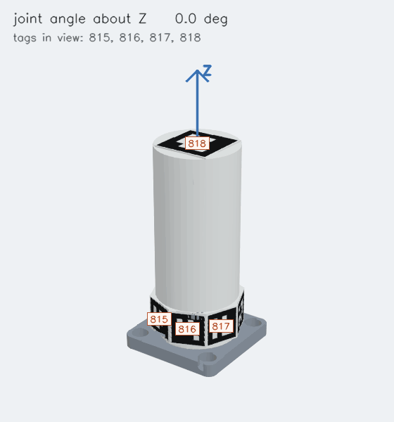
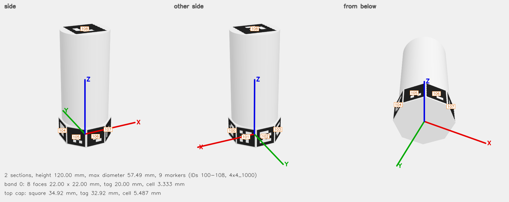
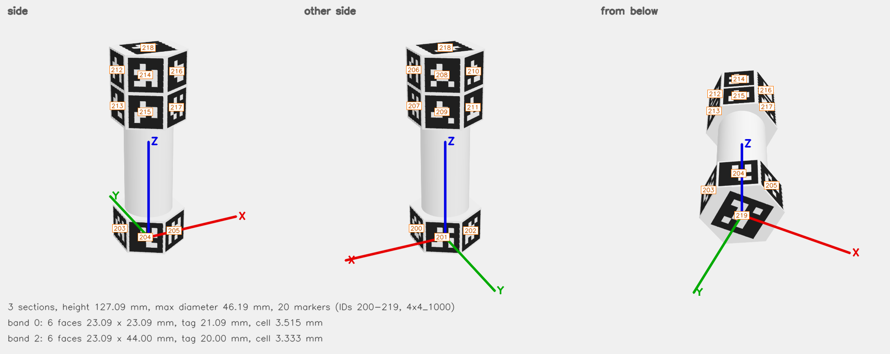
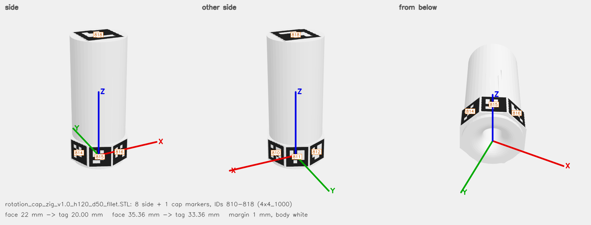
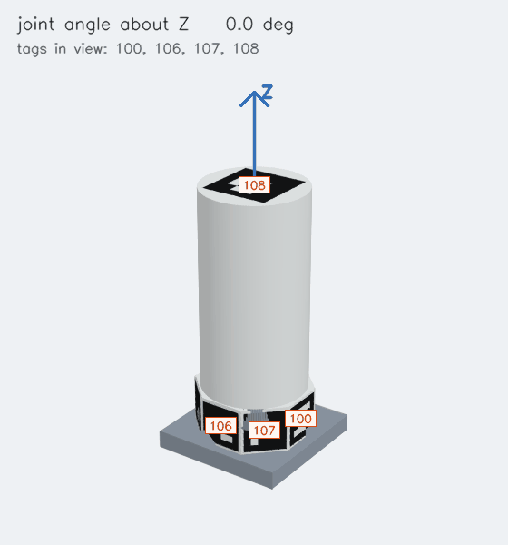

# aprilcylinder

<p align="center">
  <a href="https://jaylee00.github.io/aprilcylinder/"></a>
</p>
<p align="center"><b><a href="https://jaylee00.github.io/aprilcylinder/">Open the interactive 3D viewer</a></b>: drag to orbit, turn the 1-DoF joint about Z, see which tags face the camera.</p>

3D-printable **cylindrical fiducial targets** and **rotation-angle / axis tracking** for round objects,
built on [aprilcube](https://github.com/younghyopark/aprilcube) by Younghyo Park and Pulkit Agrawal.

Markers cannot be printed on a curved surface without distorting them, so aprilcylinder puts them on
flat **polygonal bands** around the shaft (and on the end faces). Every marker has a unique ID and
its corners are known in the target frame, so **one image gives the absolute angle about the axis**
and the axis position. Nothing is integrated over time, so tracking recovers correctly after
occlusion.



What it does:

| Command | What it makes |
|---|---|
| `aprilcyl cylinder` / `aprilcyl generate` | Cylinder + polygonal marker bands + end-face markers as a 2-colour Bambu Studio **3MF**, a detector `config.json` and a preview |
| `aprilcyl paint-stl` | Markers on the flat square faces of **your own CAD part** (STL), shape unchanged |
| `aprilcyl merge` | Several targets and plain STL parts in **one 3MF**, each movable on its own |
| `aprilcyl selftest` | Synthetic render + real detector: detection rate and angle error **before printing** |
| `aprilcyl track` / `CylinderTracker` | Live **angle about the axis**, unwrapped turns, tilt and **axis position** |
| `aprilcyl view` / `aprilcyl export-obj` | **3D viewer** (one HTML file) with the target turning about Z on its fixture; OBJ for CAD tools |

Detection is done by aprilcube's detector (multi-marker PnP with RANSAC, LM refinement and a Kalman
filter); `config.json` files written here are read by it unchanged.

## Install

```bash
pip install git+https://github.com/JayLee00/aprilcylinder
```

Python 3.10+. Installs `aprilcube`, `opencv-contrib-python` (4.x), `numpy` and `pyyaml`.

## Make a target

Quick form: a 50 mm shaft, 120 mm long, with an octagonal band of 22 mm faces at the bottom and a
marker on the top face.

```bash
aprilcyl cylinder --diameter 50 --height 120 --sides 8 --face 22 --bands bottom --first-id 100 -o models/shaft50
```

```text
2 sections, height 120.00 mm, max diameter 57.49 mm, 9 markers (IDs 100-108, 4x4_1000)
band 0: 8 faces 22.00 x 22.00 mm, tag 20.00 mm, cell 3.333 mm
top cap: square 34.92 mm, tag 32.92 mm, cell 5.487 mm
mesh closed: True, volume 243758.4 mm3 (expected 243758.4), triangles 1824
```

Output folder: `shaft50.3mf` (for the slicer), `config.json` (for the detector), `thumbnail.png`.

| Option | Default | Meaning |
|---|---|---|
| `--diameter`, `--height` | required | Shaft diameter and total height (bands included), mm |
| `--sides` | 8 | Faces of the band (6 = hexagon, 8 = octagon, ...) |
| `--face` | band clears the shaft by 1.5 mm | Band face width, mm |
| `--band-height` | = face width | Band height; a taller band does not enlarge the tag, use `rows` in YAML for that |
| `--bands` | `bottom` | `bottom`, `top`, `both` or `none` |
| `--no-top-marker`, `--bottom-marker` | top on, bottom off | End-face markers |
| `--margin` | 1.0 | White margin around each marker, mm |
| `--body` | `white` | `white` (black marker cells) or `black` (white cells) |
| `--dict` | `4x4_1000` | ArUco dictionary (`4x4_*`, `5x5_*`, `6x6_*`, `apriltag_36h11`) |
| `--first-id` | 0 | First marker ID. **Give every target in one scene its own range** |
| `--phase` | 0 | Rotate the band so face 0 points at this angle (deg) |

### Any stack of bands and shafts (YAML)

A target is a stack of sections from bottom to top. Neighbouring sections must be strictly nested
(one fully inside the other in outline), which is what a band on a shaft looks like.

```yaml
# examples/two_bands_hex.yaml
output: models/two_bands_hex
dictionary: 4x4_1000
first_id: 200
margin_mm: 1.0
body: white
sections:
  - {type: polygon, sides: 6, across_flats_mm: 40, height_mm: 23.09}
  - {type: cylinder, diameter_mm: 30, height_mm: 60}
  - {type: polygon, sides: 6, across_flats_mm: 40, height_mm: 44, rows: 2}   # 2 markers per face
caps:
  top: {marker: true}
  bottom: {marker: true}
```

```bash
aprilcyl generate examples/two_bands_hex.yaml
```



Polygon sections take `face_mm`, `apothem_mm` or `across_flats_mm`, plus `height_mm` (default: square
faces), `rows` (markers stacked on each face) and `markers: false` for a plain band. Cylinder
sections take `diameter_mm` or `radius_mm`. Caps take `marker` and optionally `square_mm`
(marker square including margin; by default the largest that fits).

### Your own CAD part

Model the faces that should carry markers as **exact flat squares** (e.g. an octagonal band in
SolidWorks), export a binary STL, and paint them:

```bash
aprilcyl paint-stl part.STL --up-axis y --first-id 300 -o models/part
```

Every flat square face of at least `--min-size` mm (default 15) made of two triangles gets one
marker. Only those faces are re-meshed; the mesh stays closed and the volume is unchanged.
`--up-axis` names the STL axis that becomes +Z (SolidWorks exports are usually `y`). Faces with a
fillet or hole running into them are not squares and are skipped.

A worked example with a real part is below.

## Example: a rotation jig

[`examples/rotation_jig`](examples/rotation_jig) is a real 1-DoF jig used in experiments: a printed cap
(50 mm shaft, 120 mm long, filleted) slides over the 15 mm post of a 64 x 64 mm base and turns about
Z. The cap was modelled in SolidWorks with an octagon of **22 mm square faces** at the bottom and a
**square inscribed in the top face** (35.36 mm), and nothing else was changed.



The animation at the top of this page and the first scene of the
[3D viewer](https://jaylee00.github.io/aprilcylinder/) are this jig.

```bash
cd examples/rotation_jig
aprilcyl paint-stl rotation_cap_zig_v1.0_h120_d50_fllet.STL --up-axis y --first-id 810 -o cap_h120
aprilcyl selftest cap_h120 --distance 400 700
aprilcyl view cap_h120 --fixture rotation_base_zig_v1.1.STL --fixture-up-axis y --fixture-axis 25 25 --seat 8 -o jig.html
```

```text
rotation_cap_zig_v1.0_h120_d50_fllet.STL: 8 side + 1 cap markers, IDs 810-818 (4x4_1000)
face 22 mm -> tag 20.00 mm   face 35.36 mm -> tag 33.36 mm   margin 1 mm, body white
mesh closed: True, volume 215392.9 mm3 (original 215392.9), triangles 5202
```

| Distance | View | Detected | Angle error mean / max |
|---|---|---|---|
| 400 mm | side | 36 / 36 | 0.34 / 1.37 deg |
| 400 mm | 45 deg | 36 / 36 | 0.15 / 0.48 deg |
| 400 mm | top | 36 / 36 | 0.15 / 0.81 deg |
| 700 mm | side | 36 / 36 | 0.93 / 4.04 deg |
| 700 mm | 45 deg | 36 / 36 | 0.41 / 1.59 deg |
| 700 mm | top | 34 / 36 | 0.17 / 0.56 deg |

The folder holds the STLs, the painted 3MFs ready for Bambu Studio and the detector `config.json`
files. `cap_50mm` is a shorter cap of the same design (IDs 800-808); its bore is closed 88 mm up, so
it does not fit this base, whose post stands 100 mm above the plate. Track the jig with

```python
trk = CylinderTracker("examples/rotation_jig/cap_h120", intrinsics)
```

and `st.angle_deg` is the joint angle. The fillet does not matter: only the flat squares carry tags.

## Print (Bambu Studio)

1. Open the `.3mf`. Filament **1 = black, 2 = white** (PLA, matte if you have it).
2. **Pick a system process preset** (e.g. `0.20mm Standard`). If the process box shows the file name,
   the slicer is using built-in defaults (very slow accelerations); a single part can come out at days.
3. Check that the body shows in the right colour. A white-body target is filament 2 with the black
   cells painted with filament 1; if it shows all black, set the object's filament to 2.
4. **Do not scale.** The detector trusts the dimensions in `config.json`. Move and rotate freely.

To print targets together with other parts on one plate:

```bash
aprilcyl merge models/shaft50 models/part other_part.stl --stl-filament 2 --stl-up-axis y -o plate.3mf
```

Every input stays a separate object with its own colours. Bambu project files that already contain
several objects or settings cannot be merged by this tool; drag the target into them in Bambu
Studio instead.

## Track

```python
from aprilcylinder import CylinderTracker

trk = CylinderTracker("models/shaft50", {"fx": 910, "fy": 910, "cx": 640, "cy": 360}, fast=True)

st = trk.process(frame)              # BGR image
if st.success:
    st.angle_deg                     # [0, 360) about the shaft axis, relative to the reference
    st.angle_unwrapped_deg           # keeps counting turns (needs < 180 deg change between frames)
    st.axis_origin_mm                # axis point at the bottom face (camera frame, mm)
    st.axis_dir                      # unit axis direction (camera frame)
    st.point_on_axis(120.0)          # any point on the axis, e.g. the top centre
    st.tilt_deg                      # tilt of the axis relative to the reference
    st.T                             # 4x4 target pose, translation in mm
```

**What 0 deg means** (`reference=`):

* `"first"` (default) - the orientation at the first successful detection.
* `"frame"` - the output frame. Use it with `extrinsic=T_world_cam` (translation in **mm**) when the
  world Z axis is the shaft axis: the angle is then measured from the world X axis.
* a 3x3 rotation - an explicit zero orientation, e.g. one measured once with the part in a fixture.
* `trk.set_reference(state=st)` re-zeros at any time.

The angle is the twist part of a swing-twist decomposition, so a wobble or tilt of the shaft does
not leak into it. The target frame has its origin on the axis at the bottom face, +Z along the axis
and +X through the centre of band face 0.

Webcam demo (press `z` to zero, `q` to quit), and a RealSense example in `examples/`:

```bash
aprilcyl track models/shaft50 --camera 0 --intrinsics calib.json
```

## See it in 3D



```bash
aprilcyl view models/shaft50 -o shaft50.html                     # the target alone
aprilcyl view models/shaft50 --fixture demo -o shaft50_demo.html  # on a generic base
aprilcyl view models/part --fixture base.STL --fixture-up-axis y --fixture-axis 25 25 --seat 8 -o jig.html
```

The page opens straight into a 3D view (three.js, needs internet) that spins the target about its
axis. Drag to orbit, use the slider to set the joint angle, toggle tag IDs and axes. The card lists
the tags that currently face the camera, which is what the detector will use at that angle.

`--fixture` adds a fixed part: `demo` (a square plate with a post), or your own STL. Give its up
axis, where the rotation axis is in it (`--fixture-axis X Y`, after re-orienting) and the height at
which the target's bottom face sits (`--seat`).

```bash
aprilcyl export-obj models/shaft50 -o shaft50.obj   # OBJ + MTL, black / white materials, mm
```

The OBJ opens in Blender, MeshLab, Fusion 360 (as a mesh) and SolidWorks (as a graphics body). The
3MF also opens directly in most CAD and 3D tools. `docs/make_media.py` rebuilds the animations and
the viewer above.

## Check a design before printing

```bash
aprilcyl selftest models/shaft50 --distance 400 700
```

Renders the painted mesh at random angles from the side, at 45 deg and from the top (1280x720,
fx = 900 px), runs the detector on every image with a fresh tracker, and compares the angle with the
truth. For the example above:

| Distance | View | Detected | Angle error mean / max |
|---|---|---|---|
| 400 mm | side | 24 / 24 | 0.37 / 0.77 deg |
| 400 mm | 45 deg | 24 / 24 | 0.15 / 0.40 deg |
| 400 mm | top | 24 / 24 | 0.13 / 0.40 deg |
| 700 mm | side | 24 / 24 | 0.85 / 3.44 deg |
| 700 mm | 45 deg | 24 / 24 | 0.27 / 0.78 deg |
| 700 mm | top | 24 / 24 | 0.13 / 0.61 deg |

These numbers are optimistic: the render has a little blur and noise but no motion blur, glare or
colour bleed. **The package has been checked on synthetic images only so far, not on printed
targets.**

## Design notes

* **Tag size in pixels matters, not millimetres.** In synthetic tests detection is solid above about
  30 px per tag edge and collapses below about 20 px. Tag size needed:
  `tag_mm = pixels x distance_mm / fx_px`. With fx = 900 px, 30 px at 500 mm needs a 17 mm tag.
* **Keep a white margin.** 1 mm margins detected as well as one-cell margins in synthetic tests; with
  no margin, markers on neighbouring band faces merge and side detection fails.
* **More band faces = smaller tags.** Face width is 58% of the across-flats size for a hexagon and 41%
  for an octagon. Octagons give more markers in view; hexagons give bigger markers on thin shafts.
* **Cell size vs nozzle.** Cells below ~2.5 mm want a 0.4 mm nozzle or smaller.
* **Different IDs for different targets.** Targets that share a dictionary and a scene must not share
  IDs.

## Tests

```bash
pip install -e ".[test]"
pytest
```

Checks that every generated mesh is closed with the analytic volume, marker corner geometry,
painting of STL parts, merging, and single-image angle and axis accuracy on synthetic renders.

## Credits

aprilcylinder is built on **aprilcube** (MIT): the detector, the multi-face PnP and the idea of
2-colour printed fiducial targets all come from it. If you use this in research, please cite
aprilcube:

```bibtex
@software{park2026aprilcube,
  title={AprilCube: 3D-Printable Fiducial Targets for Reliable 6-DoF Pose Estimation},
  author={Park, Younghyo and Agrawal, Pulkit},
  year={2026},
  url={https://github.com/younghyopark/aprilcube},
}
```

## License

MIT
